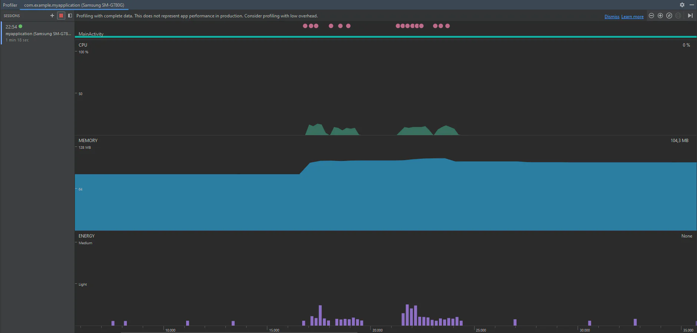
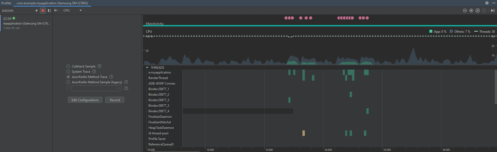
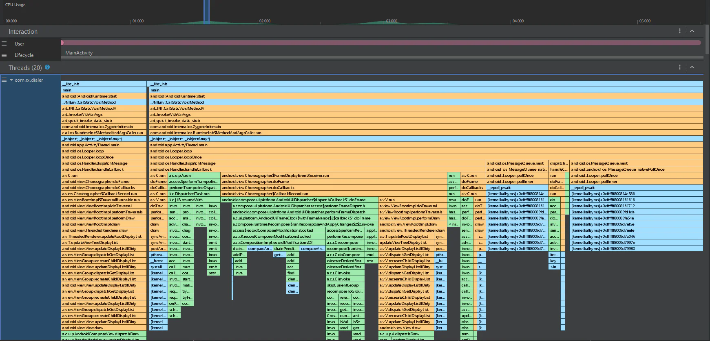
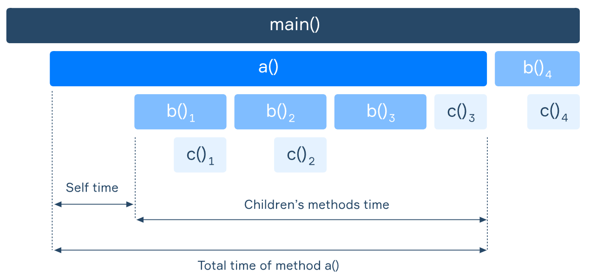
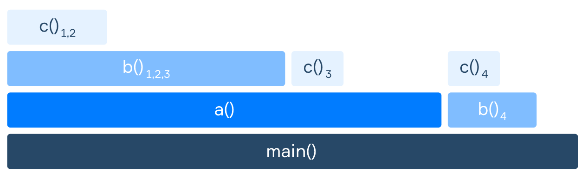

# Cấu hình CPU


Thật không may, điều đó xảy ra là chúng ta đang sống trong một thế giới có nguồn tài nguyên hạn chế.
Điều này áp dụng cho cả tài nguyên thiên nhiên và tài nguyên thiết bị máy tính, đặc biệt là thiết bị di động.
Vì lý do này, trong hầu hết các trường hợp, các nhà phát triển phần mềm buộc phải thích ứng với tài nguyên phần cứng mà hầu hết thiết bị của người dùng có khi tạo chương trình hoặc trò chơi.

Một ứng dụng có thể lý tưởng về mặt viết mã hoặc xây dựng kiến ​​trúc của nó, nhưng nó cũng có thể hoàn toàn không sử dụng được và có nhiều lỗi do sử dụng tài nguyên hệ thống không đúng cách và dưới mức tối ưu. Tối ưu hóa việc sử dụng tài nguyên ứng dụng thường rất quan trọng để mang lại trải nghiệm tốt nhất cho người dùng. Đây là nơi hồ sơ có ích.

## Lập cấu hình và Trình cấu hình Android

**Profiling** là một phương pháp phân tích việc thực hiện chương trình.
Nó giúp xác định các tắc nghẽn về hiệu suất và kiểm tra mức tiêu thụ tài nguyên hệ thống của phần mềm để tối ưu hóa và cải thiện hiệu suất ứng dụng.

**Android Profiler** là một công cụ Android Studio để lập hồ sơ theo thời gian thực về các tài nguyên được ứng dụng sử dụng, chẳng hạn như CPU, bộ nhớ và năng lượng.


Để bắt đầu lập hồ sơ, bạn cần chạy Android Profiler bằng cách biên dịch ứng dụng trên thiết bị Android thực tế hoặc trong trình mô phỏng bằng nút Profiler trên thanh công cụ trên cùng.

Nếu bạn đã biên dịch ứng dụng, hãy mở Profiler trên thanh công cụ phía dưới hoặc đi tới menu chính "View" → "Tool Windows" → "Profiler" (đừng nhầm nó với "Profile"). Sau đó, bạn sẽ thấy một cửa sổ có bốn mốc thời gian, như hiển thị bên dưới:



- Dòng trên cùng hiển thị lifecycle của hoạt động hiện tại cũng như các hành động mà người dùng thực hiện (chạm vào màn hình, lật thiết bị, nhấn các nút vật lý, v.v.).
- Ba phần tiếp theo, CPU, Bộ nhớ và Năng lượng, hiển thị việc sử dụng các tài nguyên tương ứng tại một thời điểm cụ thể. Mỗi số liệu có một phần hồ sơ riêng biệt với các công cụ và cài đặt của nó.
- Bạn có thể lưu nó thành các phiên riêng biệt để khám phá và so sánh dữ liệu tiêu thụ tài nguyên trong các tình huống khác nhau

## Cấu hình CPU

Dữ liệu sử dụng CPU của ứng dụng của bạn chứa rất nhiều thông tin có thể giúp bạn hiểu ứng dụng của bạn tiêu thụ tài nguyên CPU một cách tối ưu như thế nào,
những phương pháp nào đang sử dụng nó và bao nhiêu, mất bao lâu, v.v.

> [!NOTE]
> Khi sử dụng Trình phân tích tài nguyên Android, thời gian thực thi của các hàm hoặc phương thức có thể dài hơn đáng kể so với runtime thực tế khi không có trình phân tích tài nguyên. Điều này xảy ra vì bản thân Trình phân tích tài nguyên Android tiêu tốn tài nguyên hệ thống, điều này có thể làm chậm quá trình thực thi và ảnh hưởng đến thời gian được ghi.
> Thay vì dựa vào giá trị thời gian tuyệt đối, hãy tập trung vào khoảng thời gian tương đối giữa các chức năng khác nhau. Ví dụ:
> - Nếu Hàm A có vẻ mất nhiều thời gian hơn Hàm B trong trình lược tả, thì có khả năng nó cũng thực hiện như vậy trong quá trình thực thi thực tế.
> - Tuy nhiên, thời gian chính xác (ví dụ: 200 mili giây trong trình lược tả thực tế có thể là 50 mili giây) có thể không chính xác.


Để bắt đầu lập hồ sơ CPU, hãy nhấp vào CPU graph.
Bạn sẽ thấy danh sách tất cả các thread được ứng dụng của bạn sử dụng. Khi có bất kỳ hoạt động nào trong ứng dụng, dòng thời gian của các chủ đề sẽ được đánh dấu bằng một màu nhất định.
Mỗi màu tương ứng với một trạng thái cụ thể của thread đó.



- **Xanh lục**: thread đang hoạt động và đang sử dụng CPU.

- **Vàng**: thread đang hoạt động nhưng đang chờ thao tác I/O, sau đó nó có thể hoàn thành công việc của mình.

- **Xám**: thread đang ngủ và không sử dụng CPU.

## Ghi lại dấu vết

Dấu vết là bản ghi hoạt động của thiết bị trong một khoảng thời gian nhất định. 
Để có hồ sơ CPU chi tiết và chuyên sâu hơn, Android Profiler cung cấp khả năng ghi lại tất cả thông tin về quá trình thực thi của ứng dụng và việc sử dụng CPU.

Tùy thuộc vào loại thông tin bạn muốn thu thập, bạn có thể chọn một trong các cấu hình ghi theo dõi sau:

### 1. System Trace (Theo dõi cuộc gọi hệ thống hoặc Systrace)

Cấu hình này ghi lại thông tin chi tiết mà bạn có thể xem cách ứng dụng tương tác với tài nguyên hệ thống.
Ngoài ra, các bản ghi còn chứa thời gian và khoảng thời gian chính xác về trạng thái của các thread của ứng dụng.

Không giống như các công cụ khác, Systrace cung cấp dữ liệu mục tiêu như mức sử dụng CPU trên tất cả các lõi hoặc thông tin quan trọng khác mà Systrace tự động thu thập, chẳng hạn như khung lifecycle.

Nó cũng cho chúng tôi biết liệu một khung hình có mất hơn 16 mili giây hay không (1 s/60 khung hình/giây = 16 mili giây mỗi khung hình) và cho biết điều gì có thể sai cũng như cách chúng tôi có thể khắc phục.

> [!WARNING]
> Mặt khác, mặc dù thông tin này rất hữu ích nhưng nó không xuất hiện trong ngữ cảnh call stack của ứng dụng. Nói cách khác, chúng tôi không thể khớp nó với mã chúng tôi đã viết.
> Tuy nhiên, có nhiều trường hợp Systrace có thể hữu ích, đặc biệt nếu bạn đang theo dõi một đoạn mã cụ thể. 
> Trong trường hợp này, bạn có thể thêm [sự kiện theo dõi tùy chỉnh](https://developer.android.com/topic/performance/tracing/custom-events) — điểm đánh dấu cho biết khu vực nhất định sẽ được hiển thị trong call stack. Do đó, bạn sẽ có thể khớp dữ liệu mà Systrace cung cấp cho bạn với mã bạn đã viết.

### 2. Dấu vết phương thức Java/Kotlin

Đặc điểm nổi bật của cấu hình này là nó theo dõi từng chức năng được thực thi,
thu thập và so sánh dấu thời gian ở đầu và cuối mỗi lệnh gọi phương thức để tạo dữ liệu theo dõi phương thức, bao gồm thông tin về thời gian và mức tiêu thụ CPU.

Vì vậy, tất cả các chức năng này sẽ được hiển thị trong call stack.
Tuy nhiên, cách tiếp cận này, như bạn có thể đoán, có một nhược điểm đáng kể.
Method Trace sử dụng các tài nguyên CPU bổ sung ảnh hưởng đến hiệu suất ứng dụng, từ đó ảnh hưởng đến dữ liệu lược tả, đặc biệt đối với các phương thức có lifecycle ngắn.
Nếu bạn đang giám sát những địa điểm có mật độ cuộc gọi cao, rất có thể bạn sẽ nhận được dữ liệu hiệu suất runtime bị sai lệch cho ứng dụng của mình.

### 3. Mẫu Callstack (Hàm mẫu C/C++)

Cài đặt này thu thập các mẫu lệnh gọi của các hàm C/C++ gốc theo định kỳ trong khi ứng dụng của bạn đang chạy.

Bạn có thể điều chỉnh khoảng thời gian lấy mẫu để kiểm soát tần suất thu thập dữ liệu.
- Khoảng thời gian dài hơn làm giảm tác động của trình phân tích hồ sơ đến hiệu suất nhưng cung cấp dữ liệu ít chi tiết hơn, nghĩa là bạn có thể bỏ lỡ các lệnh gọi hàm quan trọng.
- Khoảng thời gian ngắn hơn cung cấp nhiều dấu vết chi tiết hơn nhưng có thể ảnh hưởng đến hiệu suất ứng dụng, khiến dữ liệu được thu thập kém chính xác hơn.

### 4. Mẫu phương thức Java/Kotlin - kế thừa (Phương thức Java mẫu)

Với cấu hình này, Profiler ghi lại call stack theo định kỳ trong khi ứng dụng đang chạy. Sau đó, Profiler so sánh dữ liệu nhận được và hiển thị thông tin về thời gian cũng như mức sử dụng tài nguyên hệ thống của ứng dụng.

Lưu ý rằng vấn đề chính với phương pháp này là các phương pháp tồn tại trong thời gian ngắn (các phương pháp thực thi nhanh) có thể không được ghi lại vì chúng có thể kết thúc trước khoảng thời gian lấy mẫu tiếp theo. Điều này có nghĩa là bạn có thể bỏ lỡ các chi tiết quan trọng về việc thực hiện chúng. Để tránh điều này, hãy sử dụng Method Trace hoặc Systrace với các sự kiện tùy chỉnh.

## Kiểm tra dấu vết

Nếu bạn mở bản ghi được yêu cầu, ở trên cùng, bạn sẽ thấy cách sử dụng CPU graph quen thuộc và ngay bên dưới hành động của người dùng,
lifecycle của hoạt động cũng như danh sách các thread được ứng dụng sử dụng.
Mỗi thread có Biểu đồ cuộc gọi riêng — trình bày trực quan về các phương thức và dấu vết chức năng của ứng dụng, thời điểm cuộc gọi của chúng,
thời gian thực hiện, bao gồm cả các phần tử con của chúng. Để mở Biểu đồ cuộc gọi, hãy nhấp vào hình tam giác bên cạnh tên của thread.



Màu sắc của mỗi phương thức hoặc hàm tương ứng với loại của nó:

- **Cam** — thuộc API hệ thống;

- **Blue** — các phương thức và hàm gốc;

- **Xanh** — call stack của các phương thức và chức năng trong ứng dụng của bạn (chúng quan tâm ngay từ đầu).

Chúng ta hãy xem khái niệm sắp xếp phương thức bằng ứng dụng này làm ví dụ:

```kotlin
fun main() {
   a()
   b(true)
}

fun a() {
   b(true)
   b(true)
   b(false)
   c()
}

fun b(callC: Boolean) {
   if (callC) { c() }
}

fun c() { ... }
```

Chúng tôi có hàm `main()` chứa và thực thi một số hàm phụ.
Độ dài của mỗi hàm này tương ứng với thời gian thực hiện tương đối của nó.
Thời lượng thực thi của một hàm là tổng thời gian thực hiện của một hàm đó cộng với tổng thời gian thực hiện của các hàm phụ của hàm đó.



Dữ liệu theo dõi chi tiết nằm ở cửa sổ bên phải của Android Profiler. Chúng ta hãy xem nhanh từng tab.

- Tab **Flame Chart** hiển thị Call Chart. Tuy nhiên, nó nối các ngăn xếp cuộc gọi giống hệt nhau.

Ví dụ: các hàm `b()1`, `b()2` và `b()3` trong biểu đồ trên có cùng một chuỗi lệnh gọi (chính → a → b).

Theo đó, chúng sẽ được kết hợp trên Biểu đồ ngọn lửa, giống như `c()1` và `c()2`.
Tuy nhiên, `c()3` và `c()4` có chuỗi cuộc gọi khác nhau nên chúng sẽ không được kết hợp. Ngoài ra, các vật phẩm sẽ được sắp xếp theo thứ tự giảm dần về thời lượng sử dụng CPU.
Ngoài ra, các vật phẩm sẽ được sắp xếp theo thứ tự giảm dần về thời lượng sử dụng CPU.



Cách hiển thị dấu vết này rất hữu ích trong trường hợp bạn cần xem bức tranh tổng thể về thời gian thực hiện phương thức,
đặc biệt là những cái có lifecycle ngắn nhưng được chạy rất thường xuyên.

- Các tab **Top Down** và **Bottom Up** chứa các phương thức được sắp xếp theo dạng cây.
Chúng được kết hợp tương tự như chúng ta đã thảo luận ở trên. Bên phải là bảng chứa dữ liệu sử dụng CPU cho từng phương thức và các phương thức con của nó.

- Tab cuối cùng, **Sự kiện**, chứa thông tin về tất cả các cuộc gọi trong thread đã chọn. Bằng cách sắp xếp danh sách theo thứ tự mong muốn, bạn có thể nhanh chóng tìm thấy chức năng mà mình quan tâm và tiến hành kiểm tra nó.


