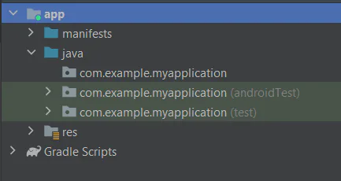
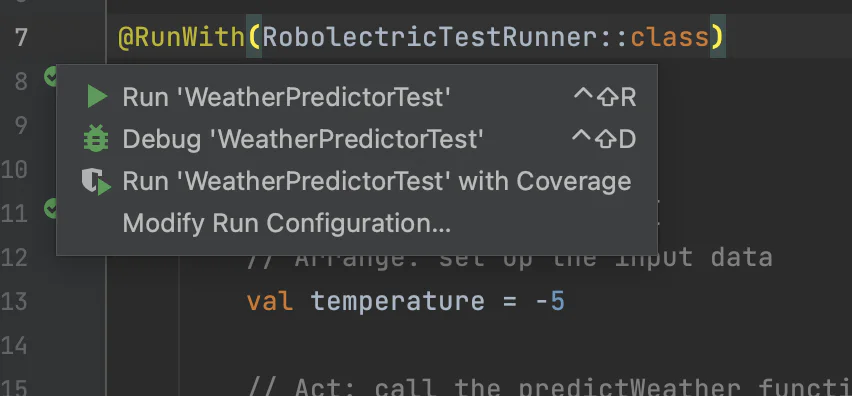
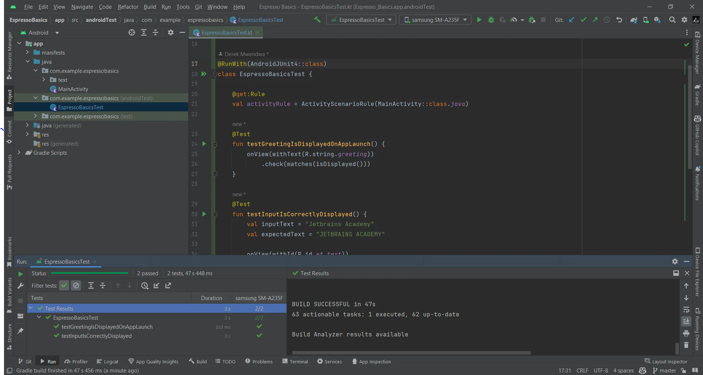

#Thử nghiệm ứng dụng Android

Thử nghiệm là một bước quan trọng trong quá trình phát triển ứng dụng vì nó cải thiện chất lượng của ứng dụng.
Mã được kiểm tra tốt sẽ dễ bảo trì và mở rộng hơn khi ứng dụng phát triển.

Ngoài ra, thử nghiệm còn mang lại cho nhà phát triển và các bên liên quan sự tin tưởng rằng ứng dụng hoạt động như dự định.

Ngoài ra, vì việc kiểm tra cho phép chúng tôi phát hiện và giải quyết sớm các vấn đề trong chu kỳ phát triển nên sẽ giảm chi phí khắc phục chúng sau này.

## Các loại thử nghiệm trong Android

Có nhiều loại thử nghiệm khác nhau, mỗi loại phục vụ một mục đích duy nhất trong quá trình phát triển process.

- **Kiểm tra đơn vị** được viết để xác minh rằng các đoạn mã cụ thể hoạt động chính xác.
Chúng tập trung vào việc kiểm tra các đơn vị hoặc chức năng riêng lẻ của mã một cách riêng biệt. Android Studio hỗ trợ việc sử dụng JUnit để viết bài kiểm thử đơn vị.

- **Thử nghiệm tích hợp** kiểm tra xem các phần khác nhau của ứng dụng phối hợp với nhau như thế nào. Chúng tôi sẽ sử dụng thử nghiệm tích hợp để đảm bảo rằng các thành phần (ví dụ: hoạt động, phân đoạn, dịch vụ) tương tác chính xác. Các công cụ như Robolectric thường được sử dụng để thử nghiệm tích hợp.

- **Thử nghiệm UI** xác minh rằng các phần tử và quy trình làm việc của UI hoạt động như mong đợi. Các thử nghiệm UI mô phỏng tương tác của người dùng với đồ họa user interface (GUI) của ứng dụng. Espresso là framework phổ biến để tạo các thử nghiệm UI trong Android Studio.

## Thiết lập môi trường thử nghiệm

Để bắt đầu thử nghiệm trong Android Studio, chúng ta cần định cấu hình dự án của mình để thử nghiệm.

Android Studio nhóm các mã khác nhau vào các thư mục có tên **bộ nguồn**

Theo mặc định, có bộ nguồn `main` chứa mã ứng dụng. Ngoài ra còn có bộ nguồn `test` dành cho kiểm tra cục bộ và `androidTest` dành cho kiểm tra thiết bị.

Kiểm tra cục bộ và kiểm tra thiết bị khác nhau về cách chúng được thực hiện:
- **Thử nghiệm cục bộ** (ví dụ: thử nghiệm đơn vị) chạy trên máy hoặc máy chủ phát triển cục bộ.
- **Thử nghiệm đo lường** (ví dụ: thử nghiệm UI) chạy trên thiết bị vật lý hoặc trình mô phỏng.


Chúng tôi cũng cần đảm bảo rằng tệp `build.gradle` của dự án của chúng tôi bao gồm các phần phụ thuộc cần thiết cho các khung thử nghiệm như JUnit, Robolectric, Espresso hoặc bất kỳ thư viện thử nghiệm nào khác mà chúng tôi dự định sử dụng

Có hai loại phụ thuộc:
`testImplementation` và `androidTestImplementation`.
Cái trước là phần phụ thuộc cho các thử nghiệm trong bộ nguồn thử nghiệm và cái sau là phần phụ thuộc cho các thử nghiệm trong bộ nguồn androidTest.



Để tạo một lớp kiểm tra, chúng ta cần nhấp chuột phải vào thư mục mà chúng ta muốn tạo bài kiểm tra của mình (ví dụ: `com.example.myapplication` (kiểm tra) cho các bài kiểm tra đơn vị).

Chọn `New` -> `Kotlin Class/File`. Hãy đặt cho lớp chúng ta một cái tên có ý nghĩa.
Ví dụ: nếu đang kiểm tra lớp Máy tính, chúng ta có thể đặt tên lớp unit test là `CalculatorUnitTest`.

## Viết bài kiểm tra đơn vị

Chúng ta có thể sử dụng các framework như **JUnit**, **Mockito** để hỗ trợ viết bài kiểm thử đơn vị.

Trong ví dụ này, chúng tôi sẽ tạo một bài kiểm tra cho lớp "WeatherPredictor" chịu trách nhiệm dự đoán thời tiết dựa trên nhiệt độ.

```kotlin
class WeatherPredictor {
    companion object {
        fun predictWeather(temperature: Int): String {
            return when {
                temperature < 0 -> "Cold"
                temperature in 0..25 -> "Moderate"
                else -> "Hot"
            }
        }
    }
}
```

Sau đây là một ví dụ về cách viết một lớp kiểm tra với các bài kiểm tra đơn vị. Hãy tạo ba phương thức thử nghiệm để kiểm tra tính logic của lớp "WeatherPredictor".

```kotlin
package com.example.hyperskilltesting

import org.junit.Test
import org.junit.Assert.*;

class WeatherPredictorTest {

    @Test
    fun testPredictColdWeather() {
        // Arrange: set up the input data
        val temperature = -5

        // Act: call the predictWeather function of the WeatherPredictor class
        val result = WeatherPredictor.predictWeather(temperature)

        // Assert: assert that the result matches the expected weather prediction
        assertEquals(result,"Cold")
    }

    @Test
    fun testPredictModerateWeather() {
        // Arrange
        val temperature = 20

        // Act
        val result = WeatherPredictor.predictWeather(temperature)

        // Assert
        assertEquals(result,"Moderate")
    }

    @Test
    fun testPredictHotWeather() {
        // Arrange
        val temperature = 30

        // Act
        val result = WeatherPredictor.predictWeather(temperature)

        // Assert
        assertEquals(result,"Hot")
    }
}
```

Chúng tôi đang sử dụng mẫu "Sắp xếp, Hành động, Khẳng định" để tổ chức trường hợp thử nghiệm của mình.

## Viết bài kiểm tra UI

Đối với các bài kiểm tra thiết bị (bài kiểm tra UI), chúng tôi sẽ tạo các lớp kiểm tra trong thư mục `com.example.myapplication` (androidTest).
Chúng tôi có thể sử dụng các khung như **Espresso** hoặc UI Automator cho thử nghiệm UI để mô phỏng tương tác của người dùng và xác minh hành vi của user interface trong ứng dụng của chúng tôi.

Hãy xem ví dụ về bài kiểm tra Espresso UI cho màn hình có chứa một nút. Chúng tôi sẽ cố gắng xác minh rằng nút này làm cho dòng chữ "Đã nhấp vào nút" xuất hiện khi được nhấp vào.

```kotlin
import androidx.test.espresso.Espresso
import androidx.test.espresso.action.ViewActions
import androidx.test.espresso.matcher.ViewMatchers
import androidx.test.ext.junit.runners.AndroidJUnit4
import androidx.test.rule.ActivityTestRule
import org.junit.Rule
import org.junit.Test
import org.junit.runner.RunWith

@RunWith(AndroidJUnit4::class)
class ButtonScreenTestKt {

    @get:Rule
    val activityRule = ActivityTestRule(ButtonActivity::class.java)

    @Test
    fun clickButton_displaysText() {
        // Click the button
        onView(ViewMatchers.withId(R.id.button)).perform(ViewActions.click())

        // Verify that the text "Button clicked" is displayed
        onView(ViewMatchers.withText("Button clicked")).check(ViewAssertions.matches(ViewMatchers.isDisplayed()))
    }
}
```

1. Chúng tôi sử dụng chú thích `@RunWith(AndroidJUnit4::class)` để chỉ định rằng chúng tôi đang sử dụng AndroidJUnit4 làm người chạy thử nghiệm.

2. Chú thích `@Rule` thiết lập `ActivityTestRule` cho `ButtonActivity`, giúp khởi chạy hoạt động thử nghiệm.

3. Chúng tôi sử dụng phương pháp `onView` của Espresso cùng với `ViewMatchers` để định vị và tương tác với các phần tử UI (ví dụ: `R.id.button`, `R.id.newScreenTextView`).

4. Chúng tôi thực hiện một hành động bằng cách nhấp vào nút bằng `ViewActions`.

5. Cuối cùng, chúng tôi sử dụng `ViewAssertions` để kiểm tra xem dòng chữ "Đã nhấp vào nút" có hiển thị hay không.

6. Một lần nữa, đừng lo lắng nếu bạn không hiểu hết mã. Hiện tại, hãy biết rằng chúng tôi đang sử dụng Espresso để kiểm tra chức năng của một nút.

## Chạy thử nghiệm và phân tích kết quả

Để chạy thử nghiệm, chúng ta có thể nhấp chuột phải vào lớp thử nghiệm hoặc thư mục thử nghiệm trong trình khám phá dự án.

Chọn "Chạy (Tên lớp kiểm tra)". Android Studio sẽ thực hiện kiểm thử và hiển thị kết quả trong cửa sổ "Chạy" hoặc "Gỡ lỗi"

Đối với các thử nghiệm đo lường, Android Studio sẽ thực hiện thử nghiệm trên trình mô phỏng hoặc thiết bị vật lý và báo cáo kết quả thử nghiệm.



Android Studio sẽ cung cấp phản hồi về việc thử nghiệm đã đạt hay không thành công.
Nếu thử nghiệm thất bại, framework sẽ cung cấp thông tin về xác nhận nào không thành công và kết quả mong đợi so với kết quả dự kiến.
giá trị thực tế, giúp chúng tôi xác định chính xác vấn đề. Khi gặp một thử nghiệm thất bại, chúng ta có thể:

- Chẩn đoán lỗi bằng cách kiểm tra mã chúng tôi đang kiểm tra, đầu vào kiểm tra, phần phụ thuộc và xác nhận.

- Xác định và khắc phục nguyên nhân gốc rễ của sự cố.

- Chạy lại bài kiểm tra để xác minh rằng nó đạt sau khi sửa lỗi.


Espresso có cấu trúc tương tự như các bài kiểm tra JUnit vì nó dựa trên JUnit, nhưng nó bao gồm các phương thức bổ sung cho phép chúng ta tương tác với user interface.
Dưới đây là một ví dụ về thử nghiệm Espresso cho ứng dụng của chúng tôi:

```kotlin
@RunWith(AndroidJUnit4::class)
class EspressoBasicsTest {

    @get:Rule
    val activityRule = ActivityScenarioRule(MainActivity::class.java)

    @Test
    fun testGreetingIsDisplayedOnAppLaunch() {
        onView(withText(R.string.greeting))
            .check(matches(isDisplayed()))
    }

    @Test
    fun testInputIsCorrectlyDisplayed() {
        val inputText = "Jetbrains Academy"
        val expectedText = "JETBRAINS ACADEMY"

        onView(withId(R.id.et_text))
            .perform(typeText(inputText), closeSoftKeyboard())

        onView(withId(R.id.rb_uppercase))
            .perform(click())

        onView(withId(R.id.bt_display))
            .perform(click())

        onView(withId(R.id.tv_display))
            .check(matches(withText(expectedText)))
    }
}
```

- Chú thích `@RunWith` từ `org.junit.runner.RunWith` được sử dụng để chỉ định người chạy thử. 

> [!NOTE]
> Người chạy thử nghiệm chịu trách nhiệm thực thi các trường hợp thử nghiệm trên thiết bị vật lý hoặc trình mô phỏng.

- Lớp `EspressoBasicsTest` chứa các trường hợp thử nghiệm của chúng tôi. 
- Trước khi thực hiện các trường hợp thử nghiệm, trước tiên chúng ta cần khởi chạy ứng dụng của mình. Bạn có thể làm điều đó bằng cách chỉ định quy tắc JUnit. 
Chú thích `@get:Rule` được sử dụng để khai báo quy tắc JUnit.  Chú thích quy tắc của JUnit được nhập từ `org.junit.Rule`.
Chúng tôi đang sử dụng `ActivityScenarioRule`, một quy tắc JUnit khởi chạy một hoạt động trước khi thử nghiệm bắt đầu và kết thúc hoạt động đó sau khi thử nghiệm kết thúc.
- chúng tôi đã chỉ định hai phương pháp thử nghiệm bằng cách sử dụng chú thích `@Test` từ `org.junit.Test`, Đây là nơi Espresso xuất hiện.
- Espresso cung cấp phương thức `onView()` từ `androidx.test.espresso.Espresso.onView`, đây là điểm truy cập của chúng tôi để tương tác với các chế độ xem. 
`onView()` lấy ViewMatcher, một [trình so khớp hamcrest](https://www.slideshare.net/shaiyallin/hamcrest-matchers) được sử dụng để định vị các chế độ xem trong hệ thống phân cấp chế độ xem hiện tại.
- Sau đó, nó trả về một đối tượng `ViewInteraction` mà chúng ta có thể sử dụng phương thức `perform()` để thực hiện các hành động trên chế độ xem phù hợp hoặc `check()` để đưa ra các xác nhận
Phương thức `perform()` lấy **ViewActions**, trong khi phương thức `check()` lấy **ViewAssertion**.

##ViewMatchers

**ViewMatchers**, như tên cho thấy, về cơ bản là các đối tượng so khớp để so khớp các chế độ xem triển khai giao diện `Matcher<View>` từ thư viện Hamcrest.
Chúng được sử dụng để chỉ định tiêu chí hoặc điều kiện tìm kiếm các chế độ xem trong hệ thống phân cấp chế độ xem hiện tại.
Một chế độ xem phải đáp ứng các điều kiện đã chỉ định để được khớp
Bạn có thể chuyển một hoặc nhiều `ViewMatchers` sang phương thức `onView()`, phương thức này trả về một đối tượng `ViewInteraction` mà bạn có thể sử dụng để thực hiện các hành động hoặc kiểm tra các xác nhận trên chế độ xem phù hợp.

Có nhiều phương thức tích hợp trả về `ViewMatchers` trong Espresso 

## Bộ so khớp View trong Espresso

| Máy so khớp | Mô tả |
|--------------------------||-------------|
| **`withId()`** | Khớp chế độ xem với ID được cung cấp. |
| **`withText()`** | Khớp chế độ xem với văn bản được cung cấp. |
| **`withContentDescription()`** | Khớp chế độ xem với mô tả nội dung được cung cấp. |
| **`isEnabled()`** | Phù hợp với chế độ xem được bật. |
| **`isChecked()`** | Khớp với chế độ xem được chọn (ví dụ: khi sử dụng hộp kiểm). |
| **`isDisplayed()`** | Khớp với chế độ xem được hiển thị một phần hoặc toàn bộ trong hệ thống phân cấp chế độ xem hiện tại. |
| **`isCompletelyDisplayed()`** | Khớp với chế độ xem được hiển thị hoàn toàn trong hệ thống phân cấp chế độ xem hiện tại. |

Bạn cũng có thể kết hợp nhiều trình so khớp bằng cách sử dụng các trình so khớp kết hợp như `allOf()` hoặc `anyOf()` và nghịch đảo một trình so khớp bằng `not()`. Ví dụ: bạn có thể viết:

```kotlin
onView(allOf(withId(R.id.button), not(withText("OK")), isDisplayed()))
```

##ViewActions

ViewActions là các đối tượng có thể được chuyển đến phương thức `ViewInteraction.perform()` để thực hiện một hành động trên một chế độ xem, chẳng hạn như nhấp, nhập, cuộn, v.v.


| Hành động | Mô tả |
|-------------------||-------------|
| **`click()`** | Thực hiện một cú nhấp chuột vào chế độ xem. |
| **`doubleClick()`** | Thực hiện nhấp đúp chuột vào chế độ xem. |
| **`longClick()`** | Thực hiện một cú nhấp chuột dài vào chế độ xem. |
| **`typeText()`** | Nhập văn bản được cung cấp vào chế độ xem `EditText`. |
| **`clearText()`** | Xóa mọi văn bản khỏi chế độ xem `EditText`. |
| **`swipeLeft()`** | Thực hiện cử chỉ vuốt sang trái trên chế độ xem. |
| **`swipeRight()`** | Thực hiện cử chỉ vuốt sang phải trên chế độ xem. |


Bạn cũng có thể xâu chuỗi nhiều `ViewActions` lại với nhau bằng cách sử dụng dấu phẩy. Ví dụ:

```kotlin
onView(withId(R.id.edit_text))
    .perform(clearText(), typeText("Hello World!"))
```

Đôi khi, bạn có thể cần thực hiện một hành động không được Espresso cung cấp hoặc tùy chỉnh một hành động hiện có.
Trong trường hợp đó, bạn có thể tạo `ViewAction` tùy chỉnh của riêng mình bằng cách triển khai giao diện `ViewAction` hoặc mở rộng một trong các lớp con của nó (chẳng hạn như `GeneralClickAction`)

##ViewAssertions

Chúng ta có thể sử dụng ViewAssertions trên phương thức `ViewInteraction.check()` để thực hiện các xác nhận về chế độ xem, chẳng hạn như kiểm tra khả năng hiển thị, văn bản, màu sắc của chế độ xem, v.v.


Phương thức `matches()` từ `androidx.test.espresso.assertion.ViewAssertions` là phương thức cơ bản nhất trả về đối tượng `ViewAssertion` có thể được sử dụng để đưa ra các xác nhận. 
Phương thức `matches()` là một phương thức trợ giúp bao bọc một đối tượng `ViewMatcher` thành một đối tượng `ViewAssertion`. 


Xác nhận `matches()` được sử dụng để xác nhận trạng thái của chế độ xem hiện được chọn. 
Nếu trình so khớp được cung cấp bên trong phương thức `matches()` khớp với các điều kiện của chế độ xem được trả về khi phương thức `onView()` được gọi thì thử nghiệm sẽ đạt. Nếu không, nó sẽ thất bại.

## Chạy thử nghiệm Espresso

Chạy thử nghiệm Espresso trong Android Studio rất đơn giản. Chỉ cần nhấp vào biểu tượng màu xanh lục bên cạnh lớp kiểm tra, sau đó **Chạy 'NameOfTestClass'** để chạy toàn bộ phương pháp kiểm tra trong lớp của bạn hoặc nhấp vào biểu tượng màu xanh lục bên cạnh một phương pháp kiểm tra cụ thể rồi **Chạy 'NameOfTestMethod'** để chạy phương pháp đó:



## Mẹo và tính năng bổ sung

Espresso cung cấp phương thức `closeSoftkeyboard()`, một hành động cấp cao nhất có thể được sử dụng để đóng bàn phím mềm.


> [!WARNING]
> Khi sử dụng closeSoftKeyboard() hoặc scrollTo(), nếu bàn phím đã đóng hoặc chế độ xem đã hiển thị trên màn hình thì các phương pháp này sẽ không có hiệu lực.

Bạn nên đóng bàn phím khi không cần thiết. Bạn cũng có thể sử dụng phương pháp `scrollTo()` để cuộn đến chế độ xem được tải nhưng tắt màn hình:


Các hành động cấp cao nhất khác bao gồm `pressBack()` và `openActionBarOverflowOrOptionsMenu(context: Context)` (được đề cập trong các chủ đề Espresso khác).

Lưu ý rằng các hành động cấp cao nhất không bị ràng buộc với bất kỳ chế độ xem cụ thể nào, ví dụ: bạn không cần `EditText` để nhấn nút quay lại nhưng bạn cần nó để thực hiện hành động gõ. Như đã nói, bạn có thể sử dụng các phương pháp này ở bất cứ đâu bạn cần trong phương pháp thử nghiệm của mình hoặc bên trong `perform()`:

```kotlin
fun test() {
    // You can use it inside perform maybe after clicking a button
    onView(...)
        .perform(click(), pressBack())

    // Or as a standalone
    pressBack()
}
```


Đối với các chế độ xem bộ điều hợp, chẳng hạn như `ListView` hoặc `GridView`, phương pháp `onView()` có thể không đủ và nên sử dụng phương pháp `onData()` thay thế.

Điều này không áp dụng cho `RecyclerView`, một chế độ xem bộ điều hợp phức tạp hơn cần xử lý đặc biệt. Phương thức `onData()` trong Espresso lấy **ObjectMatcher** làm đối số và trả về đối tượng `DataInteraction`.

Đối tượng `DataInteraction` cho phép bạn thực hiện các hành động bằng phương pháp `perform()` và các xác nhận bằng phương pháp `check()` tương tự như cách bạn thực hiện khi sử dụng `onView()` với một số chức năng bổ sung. 


