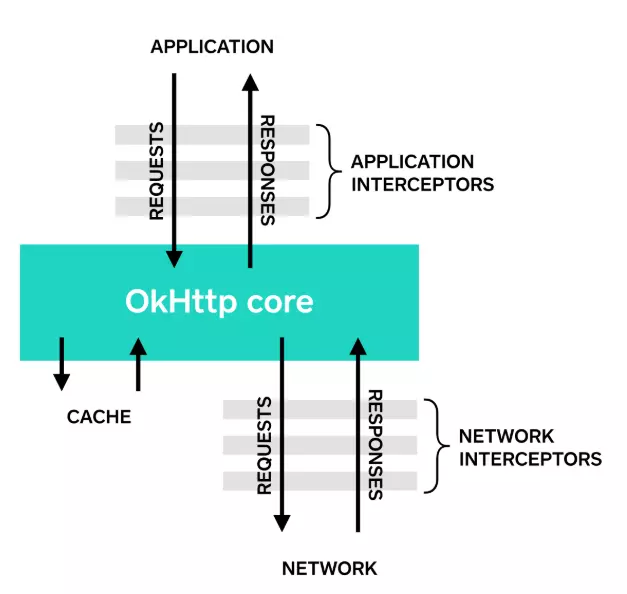

# OkHttp Interceptor

**Interceptor** trong Android là một thành phần cho phép bạn **chặn và sửa đổi** HTTP **request** và **response**.
Nó thường được sử dụng để quan sát, sửa đổi hoặc thậm chí chặn các request và response, cho phép các hành động như thêm, xóa hoặc chuyển đổi tiêu đề và dữ liệu khác.

## Các loại thiết bị chặn

Thiết bị chặn được phân thành hai loại chính:

1. **Ứng dụng Interceptor**:  
   - **Mục đích**: Chặn và xử lý các request cũng như response ở cấp ứng dụng.
   - **Đặc điểm**:
     - Được gọi một lần cho mỗi request, ngay cả khi response được lấy từ bộ đệm.
     - Thường được sử dụng để viết lại tiêu đề hoặc truy vấn cho cả request và response.
     - Không bị ảnh hưởng bởi cache HTTP.

2. **Mạng Interceptor**:  
   - **Mục đích**: Chặn và xử lý các request cũng như response ở cấp độ mạng.
   - **Đặc điểm**:
     - Chỉ được gọi cho các network request thực tế chứ không phải khi response được cung cấp từ bộ đệm.
     - Hữu ích để theo dõi các chuyển hướng, thử lại và truy cập các chi tiết request và response cấp thấp.
     - Có thể sửa đổi các tiêu đề như Mã hóa nội dung và Độ dài nội dung.

    

## Sử dụng Interceptor với OkHttp

**OkHttp** là thư viện HTTP client mạnh mẽ trong Android hỗ trợ Bộ chặn để quản lý và xử lý các request cũng như response.

### **Thêm Interceptor vào OkHttpClient**

```kotlin
val client = OkHttpClient.Builder()
    .addInterceptor { chain ->
        val originalRequest = chain.request()
        val modifiedRequest = originalRequest.newBuilder()
            .header("Authorization", "Bearer your_token")
            .build()
        chain.proceed(modifiedRequest)
    }
    .build()
```
### Thêm mạng Interceptor

```kotlin
val client = OkHttpClient.Builder()
    .addNetworkInterceptor { chain ->
        val request = chain.request()
        val response = chain.proceed(request)

        // Modify the response if necessary
        response
    }
    .build()
```


### Sử dụng tính năng ghi nhật ký Interceptor

OkHttp cung cấp `HttpLoggingInterceptor` tích hợp để ghi nhật ký các request và response HTTP.

```kotlin
val loggingInterceptor = HttpLoggingInterceptor().apply {
    level = HttpLoggingInterceptor.Level.BODY // Log request & response body
}

val client = OkHttpClient.Builder()
    .addInterceptor(loggingInterceptor)
    .build()
```


# Làm mới trường hợp sử dụng Token trong Android

Cơ chế **Refresh token** đảm bảo rằng người dùng vẫn được xác thực mà không yêu cầu họ đăng nhập thường xuyên.
Khi **access token** hết hạn, **refresh token** được sử dụng để nhận một cái mới mà không cần sự can thiệp của người dùng.

## **Flow của Cơ chế refresh token**
1. Người dùng đăng nhập và nhận **access token** và **refresh token**.
2. **access token** được sử dụng cho các request API.
3. Nếu access token hết hạn, client sẽ gửi request nhận một cái mới bằng cách sử dụng **refresh token**.
4. Nếu việc refresh token hợp lệ, server sẽ trả về **access token mới** (và đôi khi là một refresh token mới).
5. Nếu việc refresh token không hợp lệ, người dùng phải đăng nhập lại.

### **Triển khai refresh token trong Android (Kotlin + trang bị thêm + OkHttp)**

```kotlin
class AutoRefreshTokenInterceptor : Interceptor {

    companion object {
        val refTokenJWT get() = "${Configs.baseUrl}device/req/jwt"
    }

    private val logger = ApiLogger()

    private val requestIdList = mutableListOf<String>()

    private var jsonReq: String = JsonObject()
        .put("reqId", UUID.randomUUID().toString())
        .put("langCode", Lang.currentLang())
        .put("cid", androidId)
        .toString()

    override fun intercept(chain: Interceptor.Chain): Response {
        val newRequest: Request = chain.request()
        val requestId = newRequest.url.toString()
        val logger = ApiLogger()
        try {
            if (requestIdList.contains(requestId)) {
                //throw ApiProcessExistException()
            }
            logger.logRequest(newRequest)
            requestIdList.add(requestId)

            val newResponse = chain.proceed(newRequest)
            logger.logResponse(newResponse)

            return if (newResponse.code == 401) {
                /**
                 * nếu 401 gọi refresh token rồi lưu token rồi gọi lại [newRequest] bằng token mới
                 */
                requestIdList.remove(requestId)
                chain.refreshTokenAndIntercept(newRequest, newResponse)
                newResponse.close()
            } else {
                requestIdList.remove(requestId)
                newResponse
            }
        } catch (e: Throwable) {
            requestIdList.remove(requestId)
            val className = e::class.java.simpleName
            when (e) {
                is SocketException, is UnknownHostException, is SocketTimeoutException -> {
                    throw e
                }
                is HttpException -> {
                    logger.d("$className: ${e.code()} - ${e.message}")
                    logger.d("$className: ${e.errorBody()}")
                    if (e.code() == 401) {
                        val newResponse = chain.proceed(newRequest)
                        return chain.refreshTokenAndIntercept(newRequest, newResponse)
                    } else {
                        throw e
                    }
                }
                else -> {
                    logger.d("$className: ${e.message}")
                    throw e
                }
            }
        }
    }

    private fun Interceptor.Chain.refreshTokenAndIntercept(
        oldRequest: Request,
        oldResponse: Response
    ): Response {
        try {
            val request = modifiedRefreshTokenReq(oldResponse) ?: return oldResponse
            val refreshResponse = OkHttpClient().newCall(request).execute()
            if (refreshResponse.code != 200) {
                throw IllegalAccessException()
            }
            val source = refreshResponse.body?.source()
            source?.request(Long.MAX_VALUE)
            val responseBodyString = source?.buffer?.clone()?.readUtf8()
            val json = responseBodyString.toJsonObject()

            val modifiedRequest: Request.Builder = oldRequest.newBuilder()
            val dataObj = json.obj("data")
            val token: String? = dataObj.str("userToken", null)?.also { Pref.userToken = it }
            if (token.isNullOrEmpty()) {
                return oldResponse
            }
            logger.d("new call ${Pref.trusted} refreshToken $token")
            modifiedRequest.header("token", token)
            val newModifiedRequest: Request = modifiedRequest.build()
            logger.logRequest(newModifiedRequest)
            val response = this.proceed(newModifiedRequest).newBuilder().build()
            logger.logResponse(response)
            return response
        } catch (e: Exception) {
            //logger.d("new call Exception  refreshToken ${oldResponse.toJsonObject()}")
            return oldResponse
        }
    }

    private fun modifiedRefreshTokenReq(oldResponse: Response): Request? {
        val refTokenUrl = refTokenJWT
        val oldResponseBody = oldResponse.body
        val contentType = oldResponseBody?.contentType()
        val body = jsonReq.toRequestBody(contentType)
        val request = Request.Builder()
            .header("accept", "application/json")

       val refreshUserToken = Pref.refreshUserToken ?: return null
       request.addHeader("refreshUserToken", refreshUserToken)
       logger.d("old call userRefreshToken: '${refreshUserToken}'")

        return request
            .url(refTokenUrl)
            .post(body)
            .build()
    }

    private fun HttpException.errorBody(): String {
        val errorBody = response()?.errorBody()?.string() ?: return this.toString()
        return try {
            JSONObject(errorBody).toString(2)
        } catch (e: JSONException) {
            this.toString()
        }
    }


}
```